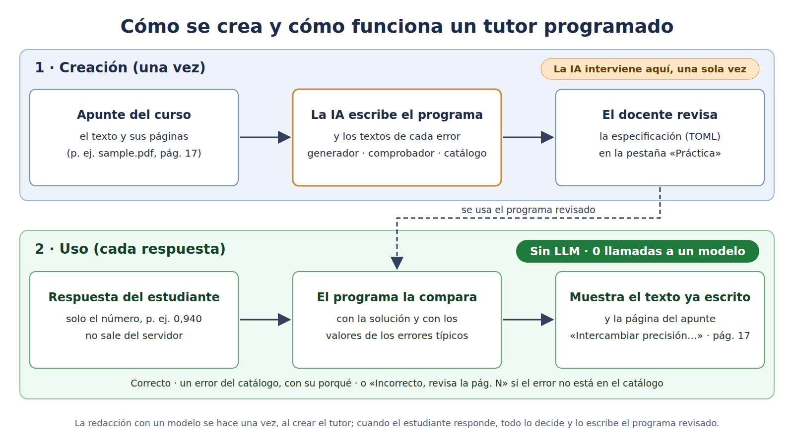

# AI Quiz (UltiR): cuestionarios y práctica a partir del apunte

Herramienta LTI 1.1 para Moodle. Se abre desde una actividad «Herramienta externa» del curso; el rol y el curso
llegan con el lanzamiento firmado.

**Para el docente.** Sube el apunte en PDF. Un modelo de lenguaje redacta preguntas de opción múltiple, cada una con
el pasaje y la página en que se basa. El docente las edita, aprueba y publica: ninguna pregunta llega al alumnado sin
esa revisión. Ve un resumen de la clase (solo con 3 estudiantes o más por pregunta) y puede exportar el cuestionario
al banco de preguntas de Moodle.

**Para el estudiante: «Practicar».** Elige un tema y un nivel y recibe un ejercicio de cálculo. Escribe su resultado
y recibe: «Correcto»; o el error típico que ha cometido, con qué ha fallado, por qué y la página del apunte; o, si el
error no está en el catálogo, «Incorrecto, revisa la pág. N», sin inventar un diagnóstico. Tiene otro intento y
después la solución, y el siguiente ejercicio vuelve sobre su último error. No cuenta para la nota.

## Cómo funciona un tutor programado

([SVG](docs/tutor-programado.svg)). La IA interviene **una vez**, al escribir el tutor; el docente lo revisa una vez;
cuando el estudiante responde **no se llama a ningún modelo** (0 llamadas). Cada tutor son dos archivos en `tutors/`:

- **Generador** (`draw` en el `.py`): saca los datos de un ejercicio para cada nivel. El motor repite el sorteo hasta
  que la solución y el resultado de cada error típico se distinguen con la precisión que pide el enunciado.
- **Comprobador** (`solve`, y `parse` / `diagnose` en `tutors/__init__.py`): calcula la solución exacta, lee lo que
  escribió el estudiante (coma decimal, «70 %») y lo compara con la solución y con cada error.
- **Catálogo de errores** (`mistakes`): el resultado que da cada error típico, p. ej. intercambiar precisión y
  exhaustividad, o redondear hacia abajo el número de iteraciones.
- **Especificación** (`.toml`): enunciados, solución y, para cada error, el título, qué ha pasado, por qué, el
  siguiente paso y la frase del apunte en que se apoya. Las páginas no se escriben a mano: salen de buscar esa frase
  en el apunte del curso. El docente la revisa en la pestaña «Práctica», junto con cuántas veces se ha detectado
  cada error (solo con 3 estudiantes o más).

La respuesta del estudiante no sale del servidor; se guardan el veredicto y el error reconocido. Tutores actuales:
`ransac_iterations` (número de iteraciones de RANSAC) y `precision_recall` (precisión, exhaustividad y F1). El
catálogo de habilidades que se prestan a un tutor está en `docs/practice/skills.md`. La práctica redactada en el
momento por un modelo sigue en el código, desactivada por defecto (`AI_QUIZ_PRACTICE_MODEL=1` la activa).

## Probarlo en local con Moodle

1. Prepara el entorno con `./apps/setup.sh`. En `web/.env` hacen falta `AI_QUIZ_LTI_SECRET` y `AI_QUIZ_ID_KEY`;
   la clave del consumidor es `ai_quiz_uma` salvo que se defina `AI_QUIZ_LTI_KEY`. Para ofrecer la práctica:
   `AI_QUIZ_PRACTICE_ENABLED=1`.
2. Arranca el servidor: `source .venv/bin/activate && cd web && uvicorn app:app --host 127.0.0.1 --port 8000`.
3. En Moodle (probado con 4.5), registra una herramienta externa LTI 1.0/1.1 con la URL
   `http://127.0.0.1:8000/lti/ai-quiz`, esa clave y ese secreto, y añádela a un curso como actividad.
4. Como docente: sube el apunte, genera, revisa y publica. Para «Practicar», actívala en la pestaña «Práctica».
5. Pruebas (con un modelo simulado, sin red): `python -m pytest -c UltiR/ai_quiz/pytest.ini UltiR/ai_quiz/tests`.

## Límites conocidos

- Solo hay **dos tutores**, de las 15 habilidades del catálogo que se prestan a uno.
- Están escritos para un apunte sintético de visión por computador (`sample.pdf`), que no está en el repositorio: un
  tutor solo se ofrece si su frase aparece en el apunte del curso.
- Se han evaluado con 56 respuestas **sintéticas escritas por el mismo autor** que los tutores (56 de 56 bien
  clasificadas). Eso mide la coherencia del programa, no cómo funciona con estudiantes reales.
- Un error que no está en el catálogo solo recibe «Incorrecto, revisa la pág. N».
- Solo LTI 1.1; las calificaciones no se envían a Moodle. Probado solo con cuentas y documentos sintéticos.
